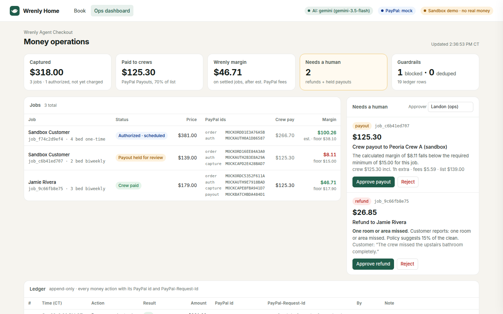
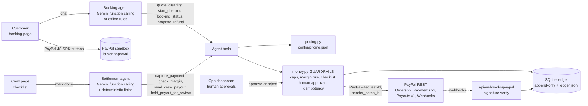
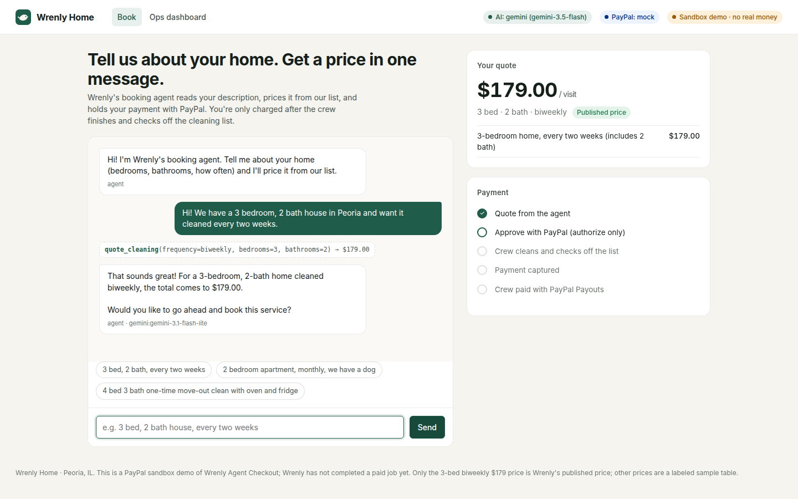
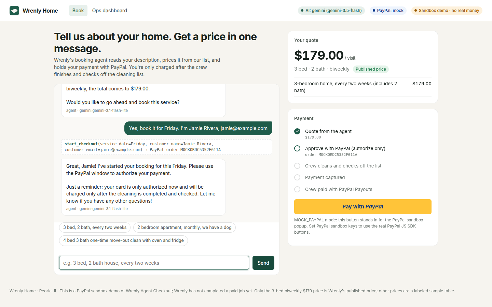
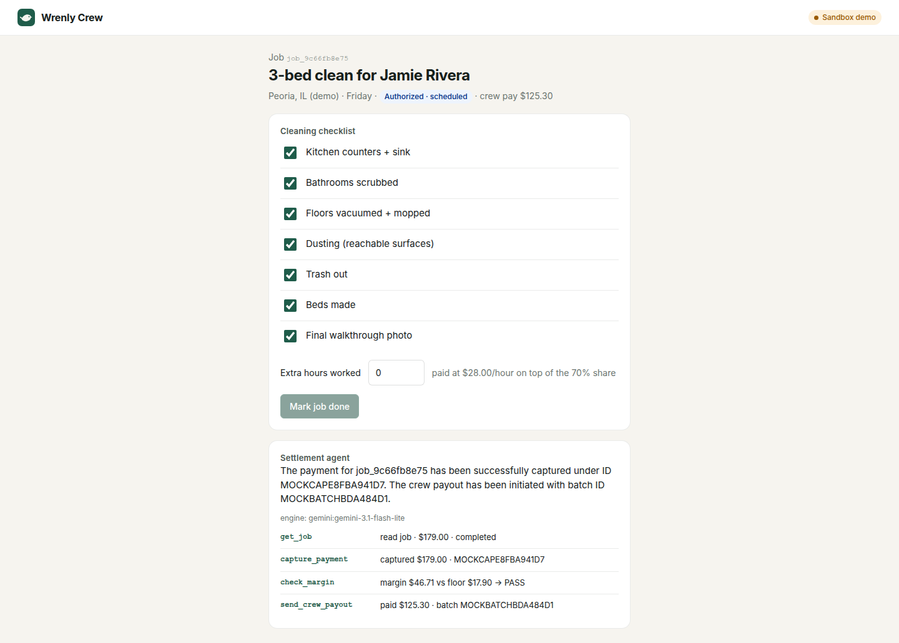
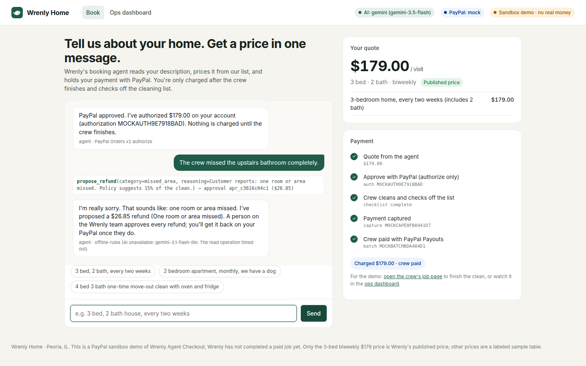
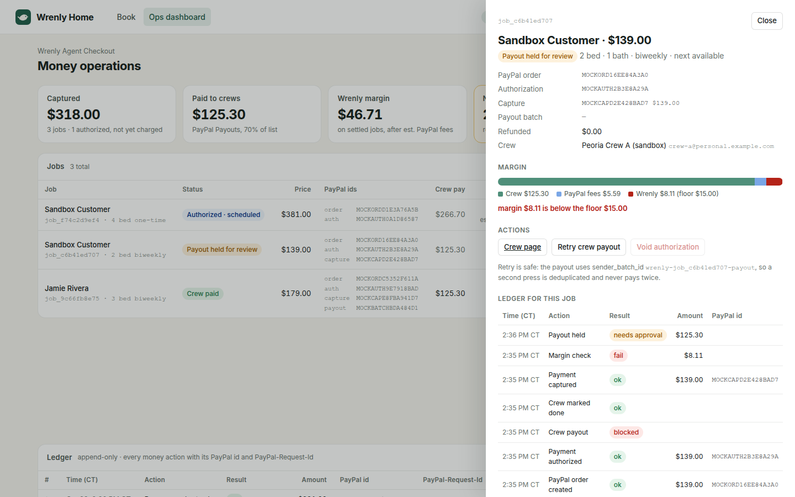
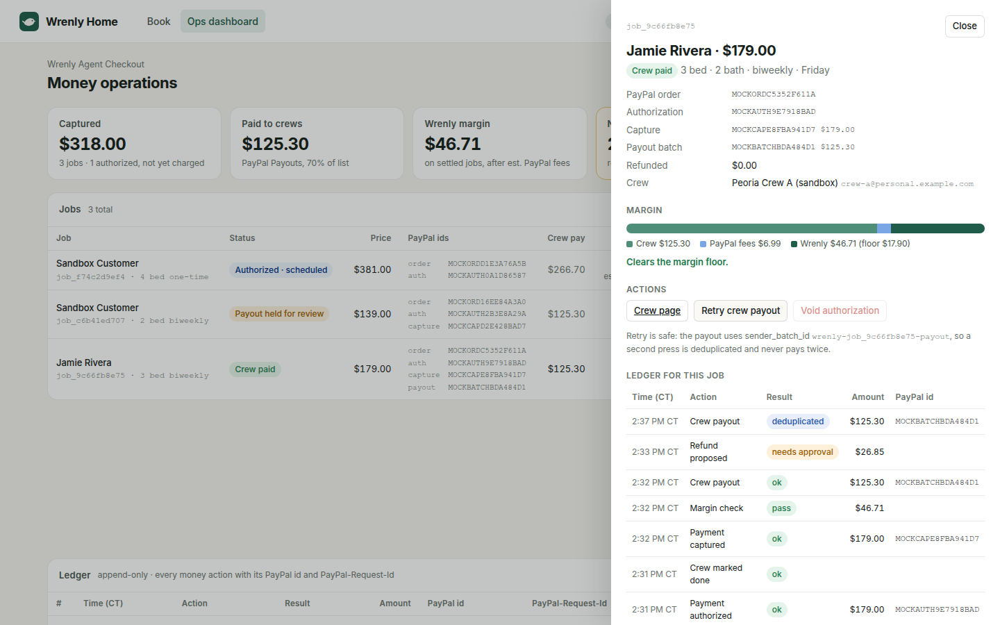

# Wrenly Agent Checkout

**An AI agent that runs the money side of a two-sided home-cleaning marketplace on PayPal:** it quotes the clean from a chat, takes payment with PayPal (authorize now, capture after the clean), pays the cleaning crew its share with PayPal Payouts after a margin check, and proposes refunds that a person approves. The AI decides what to try; code-level guardrails decide what is allowed.

> **Sandbox demo.** Everything here runs on the PayPal sandbox (or a built-in mock). Wrenly Home is a real, early-stage cleaning marketplace in Peoria, Illinois, started October 21, 2026. It has **not completed a paid job yet**; every job, customer and payment in this repo and its screenshots is test data.

Built by **Landon King, built with King AI** (King AI is an autonomous AI agent that can do anything a person can do on a computer). Significantly new: **built in October 2026** for the PayPal AI Hackathon.



## The problem

In a cleaning marketplace the website is the easy part. The hard part is the money:

- **Quoting** a home from a messy description ("3 bed, 2.5 bath, two dogs, every other week") consistently.
- **Collecting** from the customer without charging for a clean that has not happened.
- **Paying the crew** fairly and fast, without paying out more than the job brought in.
- **Refunds** when something goes wrong, without an AI giving away money on its own.
- **Never paying twice** when a button is double-clicked, a network call times out, or an agent retries.

A small marketplace cannot afford a finance team. It can afford an agent, if that agent is boxed in by rules it cannot talk its way around.

## Who it is for

Small two-sided service marketplaces (cleaning, lawn care, handyman, pet care) where a platform collects from a customer and pays a local crew, and the owner wants AI to run the routine money flow while keeping a human on every exception.

## What it does

| Step | Who | What happens | PayPal API |
|---|---|---|---|
| 1. Quote | Booking agent (AI) | Reads the customer's description, calls `quote_cleaning` with bedrooms, bathrooms, frequency and add-ons, explains the price from [`config/pricing.json`](config/pricing.json) | |
| 2. Checkout | Booking agent → customer | Calls `start_checkout`, which creates an order with `intent: AUTHORIZE` for exactly the server-side quote; the customer approves with the PayPal JS SDK buttons | Orders v2 create, authorize |
| 3. Clean | Crew | Checks off the cleaning list on the crew page and logs any extra hours | |
| 4. Settle | Settlement agent (AI) | `capture_payment` → `check_margin` → `send_crew_payout`, or `hold_payout_for_review` if the margin rule fails | Payments v2 capture, Payouts v1 |
| 5. Complaint | Booking agent → ops | Customer reports a problem; agent picks a policy category and calls `propose_refund`; a person approves it in the dashboard | Payments v2 refund |
| 6. Audit | Everyone | Every money action is appended to the ledger with its PayPal id and PayPal-Request-Id | Webhooks (optional verify) |

### The money rules (guardrails in code, not in the prompt)

All in [`app/money.py`](app/money.py), the only module that talks to PayPal. Values in [`config/policy.json`](config/policy.json).

- **Authorize, then capture.** The order is created with `intent: AUTHORIZE` for the server-side quote (the AI cannot change the price). Capture is refused until the crew marks the job done with a **complete checklist**.
- **Margin rule before any payout.** Crew share is **70% of list** (+ $28/hour for logged extra hours). After estimated PayPal fees (3.49% + $0.49 on the capture, $0.25 per payout) Wrenly must keep at least **max($15, 10% of list)**. Example: a 3-bed biweekly clean at **$179** → crew **$125.30**, fees ~**$6.99**, Wrenly **$46.71** vs a floor of **$17.90** → payout goes out automatically. A job whose crew ran over fails the check and the payout is **held for a person**.
- **Caps.** Orders ≤ $600, automatic payouts ≤ $450, refunds ≤ what is left on the capture (pending proposals count).
- **Refunds need a human.** The agent can only *propose* (`propose_refund`). Approval is a separate endpoint that refuses the decider `agent`.
- **Idempotency, two layers.** Every call carries a deterministic `PayPal-Request-Id` (`wrenly-<job>-order|authorize|capture`, `wrenly-<approval>-refund`) and the payout a deterministic `sender_batch_id` (`wrenly-<job>-payout`). Before calling PayPal, the ledger is checked for a successful action under that id; a retry is recorded as `deduped` and **nothing reaches PayPal**. If the process dies mid-call, the retry reuses the same id, so PayPal itself returns the original result instead of charging twice.
- **Append-only ledger.** SQLite triggers reject `UPDATE`/`DELETE` on the `ledger` table; every row is also mirrored to `data/ledger.jsonl`. Refused actions are logged as `blocked` with the reason.
- **Settlement always finishes.** If the AI stops early or errors, a deterministic rule completes capture → margin check → payout/hold, so a job never sits half-settled.

## Architecture



```
app/
  main.py      FastAPI routes + pages
  agent.py     booking agent + settlement agent (Gemini tool loop, offline fallback)
  gemini.py    Gemini REST client with function calling and model fallback
  extract.py   deterministic language understanding (offline mode + tests)
  pricing.py   quotes from config/pricing.json
  margin.py    the margin rule
  money.py     the guarded money layer: the only code that calls PayPal
  paypal.py    PayPal REST client + a faithful in-memory mock (MOCK_PAYPAL=1)
  db.py        SQLite: jobs, approvals, chats, webhook events, append-only ledger
static/        booking page, crew page, ops dashboard (plain HTML/CSS/JS)
config/        pricing.json (price list), policy.json (money rules)
tests/         pytest suite (mock PayPal, offline AI)
demo.py        scripted end-to-end walkthrough for the video
scripts/       sandbox_e2e.py (real sandbox run), screenshots.py (headless UI capture)
```

## PayPal APIs used

| API | Endpoint | Where |
|---|---|---|
| OAuth 2.0 | `POST /v1/oauth2/token` | `paypal.py` `RealPayPal.token` |
| Orders v2 | `POST /v2/checkout/orders` (`intent: AUTHORIZE`, `PayPal-Request-Id`) | `money.create_order` |
| Orders v2 | `GET /v2/checkout/orders/{id}` | `/api/orders/{id}`, demo + sandbox script |
| Orders v2 | `POST /v2/checkout/orders/{id}/authorize` | `money.authorize` |
| Payments v2 | `POST /v2/payments/authorizations/{id}/capture` | `money.capture` |
| Payments v2 | `POST /v2/payments/authorizations/{id}/void` | `money.void` (cancel before the clean) |
| Payments v2 | `POST /v2/payments/captures/{id}/refund` | `money.execute_refund` (after human approval) |
| Payouts v1 | `POST /v1/payments/payouts` (`sender_batch_id`) | `money.send_payout` |
| Payouts v1 | `GET /v1/payments/payouts/{batch_id}` | sandbox script status check |
| Webhooks | `POST /v1/notifications/verify-webhook-signature` | `/api/webhooks/paypal` |
| JS SDK | `paypal.Buttons` with `intent=authorize` | `static/book.js` |

## AI used

- **Google Gemini** via REST (`generateContent` with `functionDeclarations`), default model **`gemini-3.5-flash`**, falling back to `gemini-2.5-flash` and `gemini-3.1-flash-lite` when a model is overloaded or rate-limited (`GEMINI_MODEL` to change).
- Two agents, both with real function calling: the **booking agent** (4 tools) and the **settlement agent** (5 tools). The model's tool calls run through `money.py`, so a wrong or adversarial call is refused and logged as `blocked`, never executed.
- **Offline mode:** with no `GEMINI_API_KEY` (or `WRENLY_OFFLINE_AI=1`) a deterministic rules engine (`extract.py`) does the same job with the same tools, so the app, the demo and the tests all run without any AI key. If Gemini errors mid-conversation, that turn falls back to offline rules and the UI shows which engine answered.
- King AI (an autonomous AI agent) wrote most of this code, directed and reviewed by Landon King.

## Setup and run (one command)

Requirements: Python 3.10+.

```bash
git clone https://github.com/landonking0808/wrenly-agent-checkout.git && cd wrenly-agent-checkout
./run.sh
```

`run.sh` makes a virtualenv, installs `requirements.txt`, copies `.env.example` to `.env` the first time, and starts the server:

- Booking page: http://localhost:8000/
- Ops dashboard: http://localhost:8000/ops
- Crew page: linked from the booking page and from each job in the dashboard (`/crew/<job id>`)

With an empty `.env` it runs with **mock PayPal + offline AI**, so you can click through everything immediately. Add keys to `.env` to go live on the sandbox:

```ini
PAYPAL_CLIENT_ID=...          # sandbox app
PAYPAL_CLIENT_SECRET=...
PAYPAL_ENV=sandbox
CREW_PAYPAL_EMAIL=...         # a sandbox *personal* account that receives crew payouts
GEMINI_API_KEY=...            # optional, free at https://aistudio.google.com/apikey
```

Windows: `python -m venv .venv && .venv\Scripts\pip install -r requirements.txt && .venv\Scripts\uvicorn app.main:app --port 8000`.

### Scripted demo (for the video)

```bash
./run.sh                         # terminal 1, then open http://localhost:8000/ops
.venv/bin/python demo.py --pause 3   # terminal 2: walks the whole flow while the dashboard updates live
.venv/bin/python demo.py --inproc    # no server needed (mock PayPal)
```

The demo: a customer gets a $179 quote from chat → PayPal order + authorization → crew marks done → the agent captures, checks margin and pays the crew → a duplicate "pay crew" is deduplicated → a second job's early payout is refused by the guardrails, then its margin check fails and the payout is held until a person approves → the first customer complains, the agent proposes a refund, a person approves it → the ledger with every PayPal id.

### Tests

```bash
.venv/bin/python -m pytest -q
```

Covers quote extraction (offline), the price table, the margin rule, idempotency (ledger dedupe, same PayPal-Request-Id on retry, sender_batch_id), guardrails (capture before completion, payout before capture, incomplete checklist, caps, foreign order ids, agent self-approval), the append-only ledger, refunds, voids, webhooks, and the full mock PayPal flow through the HTTP API.

### Real PayPal sandbox run (API only)

```bash
.venv/bin/pip install playwright && .venv/bin/playwright install chromium   # only for the headless buyer approval
PAYPAL_CLIENT_ID=... PAYPAL_CLIENT_SECRET=... CREW_PAYPAL_EMAIL=... \
  .venv/bin/python scripts/sandbox_e2e.py --preflight      # checks the keys and the Payouts scope; moves no money
PAYPAL_CLIENT_ID=... PAYPAL_CLIENT_SECRET=... CREW_PAYPAL_EMAIL=... \
  .venv/bin/python scripts/sandbox_e2e.py --buyer-email <sandbox buyer> --buyer-password <password>
```

It runs order → buyer approval (headless sandbox login, or a sandbox test card with `--approve card`, or a link you open with `--approve manual`) → authorize → crew done → settlement agent capture + payout → payout retry (deduped) → refund proposal + approval, and writes every PayPal id to `docs/sandbox-run.json`.

## How to get PayPal sandbox credentials

1. Log in at https://developer.paypal.com (any PayPal account) and open **Apps & Credentials**, **Sandbox** tab.
2. **Create App** (type: Merchant). Copy the **Client ID** and **Secret** into `.env`.
3. In the app's features, keep **Payouts** enabled (needed for crew pay). Optional: add a **Webhook** pointing to `<your public url>/api/webhooks/paypal` and put its id in `PAYPAL_WEBHOOK_ID`.
4. Under **Testing Tools → Sandbox Accounts** you have a default *Personal* (buyer) and *Business* (merchant) account. Use the Personal account to approve checkout, and a Personal account email as `CREW_PAYPAL_EMAIL` to receive payouts. Passwords: account's **⋯ → View/Edit account**.

## Sandbox test credentials

For judges: these sandbox-only accounts can be used to approve a checkout on the hosted demo. They hold no real money.

| Role | Email | Password |
|---|---|---|
| Sandbox buyer (Personal) | `<to be filled>` | `<to be filled>` |
| Sandbox crew payout receiver (Personal) | `<to be filled>` | n/a |

## Screenshots

All in [`docs/screenshots/`](docs/screenshots/) (captured headless from the running app with `scripts/screenshots.py`, mock PayPal + Gemini):

| | |
|---|---|
|  Booking agent quotes from a tool call |  PayPal checkout (authorize only) |
|  Crew checklist → settlement agent |  Complaint → refund proposal |
|  Margin check fails → payout held |  Payout retry deduplicated |

## Honest limits

- Sandbox only. Moving to live needs a live PayPal business account approved for Payouts, real crew onboarding (Wrenly has signed no crews yet) and a tax/1099 flow.
- Only the 3-bedroom biweekly **$179** price is Wrenly's published price. Every other price in `config/pricing.json` is a labeled **sample** for the demo.
- PayPal fee figures in the margin rule are estimates from `config/policy.json`; the capture response's actual `paypal_fee` is recorded in the ledger.
- The ops dashboard has an optional shared token (`OPS_TOKEN`) rather than full user accounts.

## License

MIT, see [LICENSE](LICENSE). Copyright (c) 2026 KING HOLDINGS VENTURES LLC.
